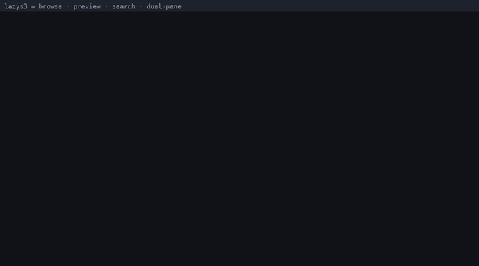
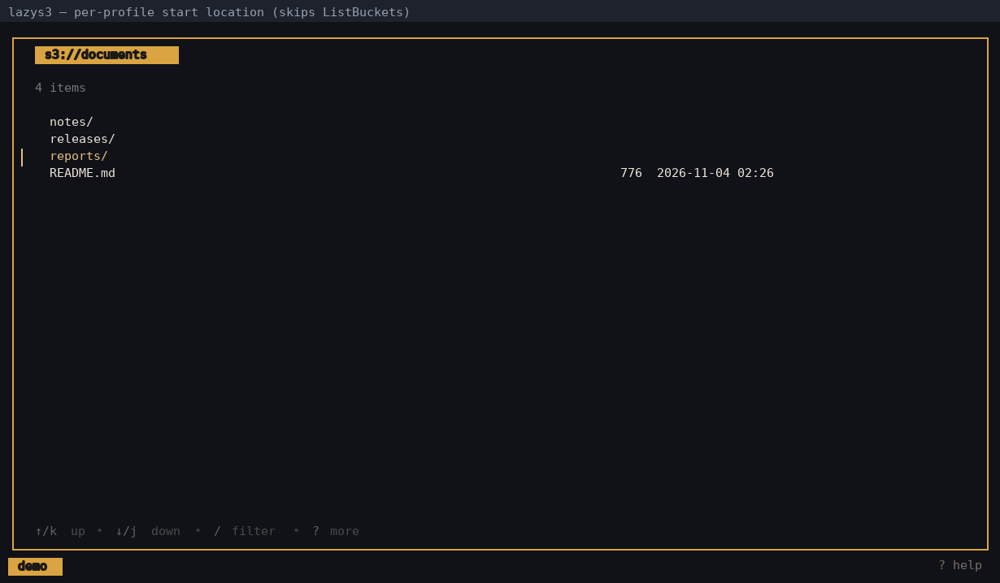
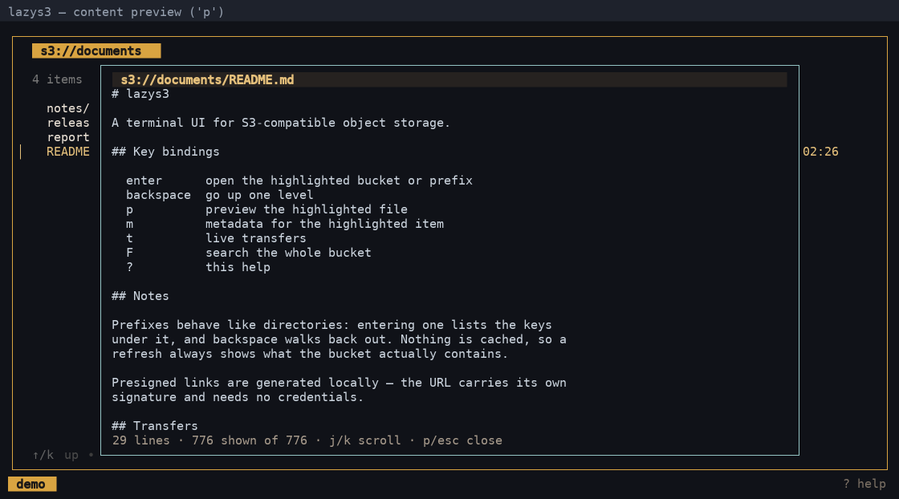
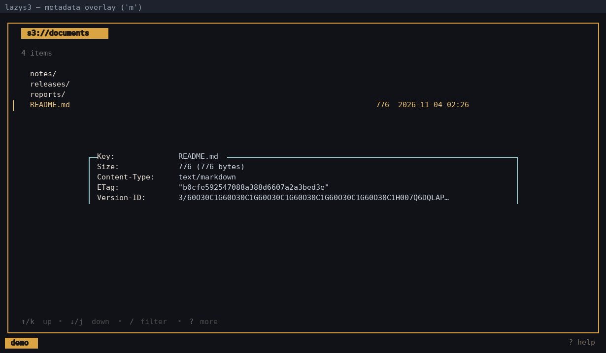
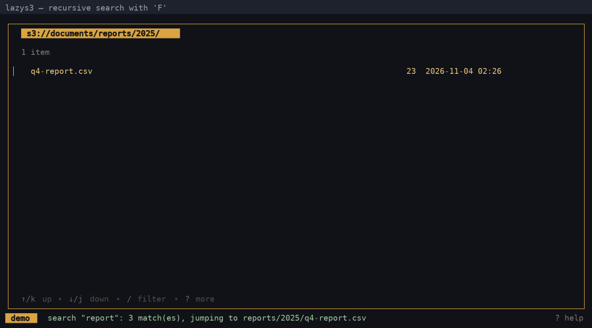
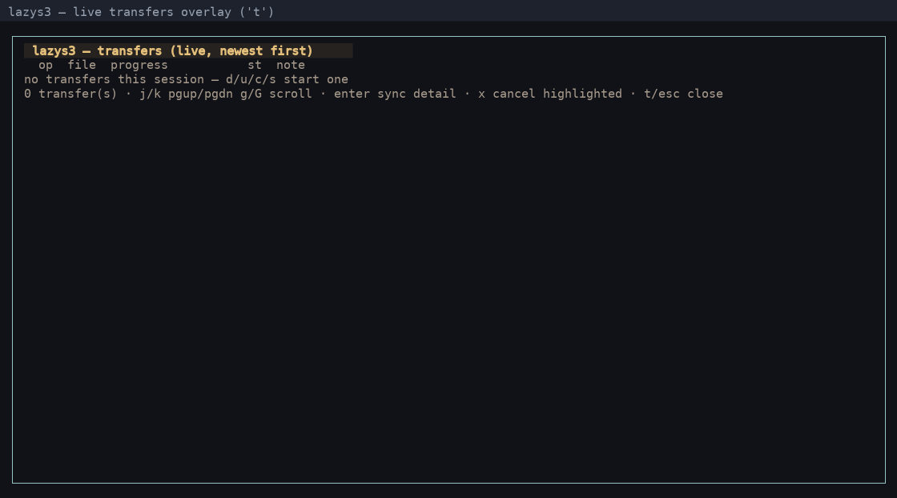
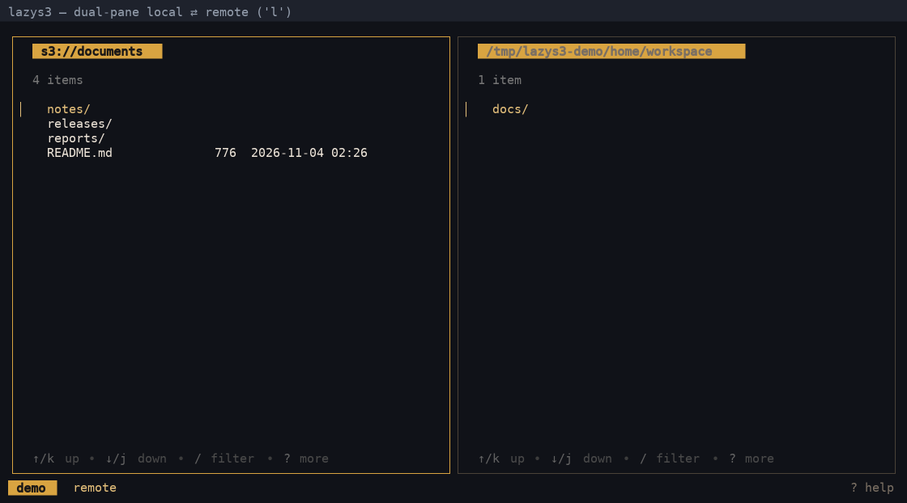
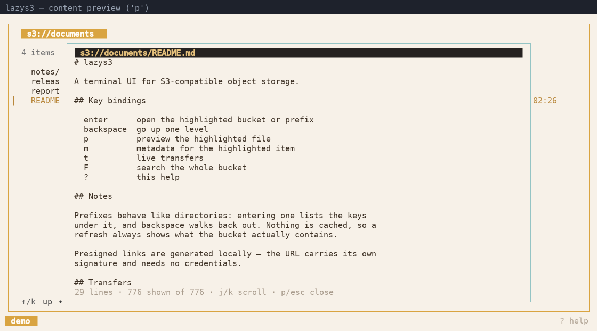

# lazys3

[English](README.md) | 简体中文

**终端里的 S3 浏览器。** 像文件管理器一样浏览 bucket 和前缀，不下载就能预览对象，
一键在本地和远端之间搬运文件——并且即使凭据没有列举 bucket 的权限，也能直接进到指定目录。



*浏览、免下载预览、全 bucket 搜索、本地 ⇄ 远端双栏 —— 由真实会话录制。*

```sh
go install github.com/LinPr/lazys3@latest
```

没有 Go 环境？直接从
[**Releases**](https://github.com/LinPr/lazys3/releases/latest) 下载静态二进制 ——
覆盖 Linux / macOS / Windows，amd64 与 arm64。

支持 AWS S3、阿里云 OSS、华为云 OBS、腾讯云 COS、MinIO、Ceph 等任何
兼容 S3 协议的服务。

---

## 一览

<table>
<tr>
<td width="50%">

**直达指定 bucket / 前缀**

按 profile 配置启动位置，完全跳过 `ListBuckets`，只有 bucket 级权限的凭据也能用。

</td>
<td width="50%">

**先看再下载**

`p` 流式拉取文件前 256 KiB，在可滚动的浮层里预览。

</td>
</tr>
<tr>
<td></td>
<td></td>
</tr>
<tr>
<td>

**完整的对象元数据**

`m` 展示 Content-Type、ETag、存储类型、SSE、校验和、用户元数据等。

</td>
<td>

**在整个 bucket 里找东西**

`F` 递归搜索并直接跳到命中的前缀。

</td>
</tr>
<tr>
<td></td>
<td></td>
</tr>
<tr>
<td>

**实时传输**

`t` 列出所有上传、下载与同步的进度；`x` 取消。

</td>
<td>

**本地 ⇄ 远端 并排**

`l` 打开双栏视图，`tab` 切换面板，文件操作跟随焦点。

</td>
</tr>
<tr>
<td></td>
<td></td>
</tr>
</table>

## 功能特性

**浏览**

- 多 Profile：读取 `~/.aws/config` / `~/.aws/credentials` 中的全部 profile，支持每个 profile 自定义 `endpoint_url`
- 自动选择寻址方式：AWS S3 与阿里云 OSS 使用 virtual-host 风格，其余自定义 endpoint 使用 path-style（OSS 不接受 path-style，因此做了特判）
- 使用 `enter` / `backspace` 在 profile → bucket → 对象之间导航，前缀表现得像目录
- 内容预览（`p`）：浮动并可滚动的浮层，显示高亮文件的前 256 KiB，自动识别二进制与空文件
- 元数据浮层（`m`）：显示高亮条目的全部非空字段 —— 对象为完整 `HeadObject`，bucket 为地域/版本控制状态，本地条目为路径/权限/属主/时间戳，profile 为配置文件路径
- 每个列表都支持过滤（`/`）、按名称/大小/时间排序（`o` / `O`）和多选（`space`、`a`）
- 递归搜索（`F`）：在整个 bucket 内查找 key，并跳到它所在的前缀

**传输**

- 双栏模式（`l`）：一侧本地文件系统、一侧 S3；`tab` 切换焦点，文件操作作用于聚焦的一栏
- 上传（`u`）与下载（`d`），文件夹通过同步引擎递归传输
- 目录同步（`s`）：本地 ⇄ S3、S3 ⇄ S3，双栏模式下自动预填两侧
- 实时传输浮层（`t`），带进度条、最新在前；`x` 取消正在运行的传输
- 路径直达（`g`）：直接跳到 `s3://bucket/prefix/` 或本地目录

**管理**

- 创建 bucket 与本地目录（`B`）、重命名（`r`）、拷贝（`c`）
- 递归删除（`D`）前缀与本地目录，以及删除空 bucket —— 全部有确认弹窗把关
- 分片清理（`P`）：列出并中止中断的多段上传 —— 这些分片在列表里看不到，但仍在计费
- 确认弹窗带 Yes/No 按钮：`tab`/方向键切换高亮，`enter` 确认，`y`/`n`/`esc` 随时可用

**版本与分享**

- 预签名下载 URL（`Y`），有效期可配（1s..168h，默认 1h），生成后复制到剪贴板
- 预签名上传 URL（`U`）：把 PUT 链接给别人，无需任何凭据即可写入当前前缀
- 对象版本（对象列表按 `v`）：下载、恢复或删除指定版本
- 切换 bucket 版本控制（bucket 列表按 `v`）：Enabled ⇄ Suspended
- 复制路径（`y`）：bucket/对象的 `s3://` URI，或本地条目的绝对路径

**启动与配置**

- 启动即进入指定 bucket / 前缀 —— 按 profile 写在 `config.yaml`，或用 `lazys3 s3://bucket/prefix/`；完全不调用 `ListBuckets`
- 按 profile 覆盖 `endpoint` / `region`，无需改动 `~/.aws/config`
- 暖色深色主题与浅色主题（`theme.mode`），支持逐项配色覆盖与可选的 Nerd Font 图标

<p align="center">
  
</p>
- 配置文件损坏不会导致崩溃 —— 非法值回退到默认值并记录日志

## 按键说明

在 lazys3 中按 `?` 即可查看这份按键表的可滚动浮层版本。

### 全局

| 按键 | 作用 |
|---|---|
| `q` | 退出 lazys3 |
| `ctrl+c` | 强制退出 |
| `?` | 开关帮助浮层 |
| `t` | 开关实时传输浮层（最新在前；`enter`：sync 逐文件明细，`←`/`→` 横向滚动宽表格） |
| `x` | 取消最近一个正在运行的传输（传输浮层内：取消高亮的那个） |
| `l` | 开关双栏布局（本地 ⇄ 远端，需要 ≥80 列） |
| `tab` | 在远端栏和本地栏之间切换焦点（双栏模式） |
| `p` | 预览文件内容（浮动浮层，前 256 KiB） |
| `m` | 对象/文件元数据（浮动浮层；也支持 bucket 和 profile） |
| `enter` / `→` | 打开选中项（profile → bucket → 对象） |
| `backspace` / `←` | 返回上一级 |
| `↑`/`k`、`↓`/`j` | 移动列表光标（也用于滚动 `?`/`t`/`v`/`p`/`m` 浮层） |

### 远端栏（S3）

| 按键 | 作用 |
|---|---|
| `d` | 下载选中对象；双栏模式下也支持文件夹，下载到本地栏当前目录 |
| `u` | 上传本地文件到当前前缀（仅单栏模式；双栏模式会提示按 `tab` —— 上传需在本地栏聚焦时执行） |
| `D` | 删除选中对象；文件夹递归删除（不可恢复）/ 删除空 bucket（bucket 列表） |
| `r` | 重命名选中对象（copy + delete 实现） |
| `c` | 拷贝选中对象到 `s3://bucket/key`（双栏模式：拷贝到本地栏） |
| `B` | 创建 bucket（bucket 列表；对象列表中只给出提示） |
| `s` | 目录同步（本地 ⇄ s3、s3 ⇄ s3；双栏模式自动预填两侧） |
| `y` | 复制高亮 bucket/对象的 `s3://` URI 到剪贴板 |
| `U` | 生成预签名上传（PUT）URL，让其他人写入这里 |
| `F` | 递归搜索：在 bucket 内查找 key 并跳转 |
| `P` | 列出并中止中断的多段上传（浑不计入列表但仍在计费） |
| `Y` | 生成预签名分享 URL（仅对象文件） |
| `v` | 对象版本（对象列表）/ 切换 bucket 版本控制 Enabled ⇄ Suspended（bucket 列表） |
| `g` | 路径直达：`s3://bucket/prefix/` 可切换 bucket，`/path` 从 bucket 根开始，`rel/path` 相对当前前缀 |

### 本地栏

| 按键 | 作用 |
|---|---|
| `u` | 上传选中项到远端 bucket/前缀（文件夹递归同步） |
| `c` | 拷贝选中项到远端栏（等同 `u`） |
| `d` | 提示按 `tab`（下载需在远端栏聚焦时执行） |
| `D` | 删除选中项（不可恢复，无回收站；目录递归删除） |
| `r` | 重命名高亮条目（同目录内） |
| `B` | 创建目录 |
| `s` | 目录同步：本地栏 → 远端栏（自动预填，可编辑） |
| `y` | 复制高亮条目的绝对路径到剪贴板 |
| `g` | 目录直达（绝对路径、`~` 或相对当前目录） |

### 选择与过滤

| 按键 | 作用 |
|---|---|
| `space` | 切换高亮条目的选中状态（✔ 标记） |
| `a` | 反选（全选 ↔ 全不选） |
| `/` | 过滤当前列表（`enter` 应用，`esc` 清除） |
| `o` | 循环切换排序字段（名称 → 大小 → 时间） |
| `O` | 反转排序方向 |

### 浮层

| 按键 | 作用 |
|---|---|
| `pgup` / `pgdn` | 翻页 |
| `g` / `G` | 跳到顶部 / 底部（帮助、传输、预览、元数据浮层） |
| `esc` | 关闭浮层（列表：清除过滤；弹窗：取消） |

## 安装

### 直接下载二进制（无需 Go 环境）

每个 [Release](https://github.com/LinPr/lazys3/releases/latest) 都附带独立
二进制。它们以 `CGO_ENABLED=0` 构建，因此 Linux 版本是**静态链接**的，在任何
发行版上都能运行，不受 glibc 版本影响。

| 系统 | 架构 | 文件名 |
|---|---|---|
| Linux | x86-64 | `lazys3-linux-amd64` |
| Linux | arm64 | `lazys3-linux-arm64` |
| macOS | Apple Silicon | `lazys3-darwin-arm64` |
| macOS | Intel | `lazys3-darwin-amd64` |
| Windows | x86-64 | `lazys3-windows-amd64.exe` |
| Windows | arm64 | `lazys3-windows-arm64.exe` |

**Linux / macOS**

```sh
# 1. 按上表下载对应平台的产物，以及校验和文件
curl -fLO https://github.com/LinPr/lazys3/releases/latest/download/lazys3-linux-amd64
curl -fLO https://github.com/LinPr/lazys3/releases/latest/download/checksums.txt

# 2. 校验（macOS 用 shasum，见下）
sha256sum --check --ignore-missing checksums.txt

# 3. 安装
chmod +x lazys3-linux-amd64
sudo mv lazys3-linux-amd64 /usr/local/bin/lazys3   # 或：~/.local/bin/
lazys3 --version
```

**校验前不要改文件名**：`checksums.txt` 是按原始文件名记录的，先改名会让
`--ignore-missing` 把所有条目都跳过，等于没校验。

macOS 上对应的命令是 `shasum -a 256 -c --ignore-missing checksums.txt`
（`sha256sum` 属于 GNU coreutils，macOS 默认不带）。

`latest/download/` 这个地址永远指向最新版本，以后升级也不用改命令。

macOS 默认不允许运行从网络下载的未签名二进制。如果提示
*"cannot be opened because the developer cannot be verified"*，
执行一次下面的命令去掉隔离标记即可：

```sh
xattr -d com.apple.quarantine ./lazys3-darwin-arm64   # 换成你下载的文件名
```

**Windows** —— 在 [Releases 页面](https://github.com/LinPr/lazys3/releases/latest)
下载对应架构的 `.exe`，重命名为 `lazys3.exe`，放到 `%PATH%` 中的目录
（例如 `%LOCALAPPDATA%\Microsoft\WindowsApps`）。

### 通过 Go 安装

需要 Go 1.27+。

```sh
go install github.com/LinPr/lazys3@latest
```

二进制会装到 `$(go env GOPATH)/bin`，多数环境已在该路径下。
`lazys3 --version` 会显示安装的版本号（`go install` 无法传链接参数，因此这里
从 Go 的 build info 读取）。

### 从源码构建

```sh
git clone https://github.com/LinPr/lazys3.git
cd lazys3
go build .          # 或：task build
```

### Shell 补全

`lazys3` 支持 bash / zsh / fish / PowerShell 的命令行参数补全：

```sh
lazys3 completion zsh > "${fpath[1]}/_lazys3"     # zsh
lazys3 completion bash > /etc/bash_completion.d/lazys3
```

## 快速上手

lazys3 读取标准的 AWS 共享配置。在 `~/.aws/config` 中为每个存储账号建一个 profile：

```ini
# ~/.aws/config
[default]
region = us-east-1

[profile oss]
region = cn-hangzhou
endpoint_url = https://oss-cn-hangzhou.aliyuncs.com
```

密钥放在 `~/.aws/credentials`：

```ini
# ~/.aws/credentials
[default]
aws_access_key_id = YOUR_ACCESS_KEY_ID
aws_secret_access_key = YOUR_SECRET_ACCESS_KEY

[oss]
aws_access_key_id = YOUR_ACCESS_KEY_ID
aws_secret_access_key = YOUR_SECRET_ACCESS_KEY
```

`default` profile 指向 AWS S3；带 `endpoint_url` 的 profile 指向对应的 S3 兼容服务（MinIO、阿里云 OSS 等）。path-style 与 virtual-host 寻址会按 endpoint 自动选择。

然后启动：

```sh
lazys3
```

选择一个 profile，按 `enter` 列出 bucket，随时按 `?` 查看完整按键表。

如果凭据只有 bucket 级权限、`s3:ListAllMyBuckets` 被拒绝，可以完全跳过 bucket 选择：

```sh
lazys3 --profile oss s3://my-bucket/logs/      # profile 与启动位置都由命令行指定
```

## 配置

lazys3 读取 `$XDG_CONFIG_HOME/lazys3/config.yaml`（默认 `~/.config/lazys3/config.yaml`）。首次运行会写入一份带注释的模板，方便发现所有配置项。所有键都是可选的；非法值会回退到内置默认值并记录日志。

```yaml
# lazys3 configuration.
# All keys are optional; the commented values show the built-in defaults.

theme:
  # mode: "dark"                   # built-in palette: dark | light
  # Colors are hex strings: "#rgb" or "#rrggbb"; the keys below override
  # individual entries of the chosen palette.
  # focused_border: "#D9A441"    # border of the focused pane
  # unfocused_border: "#4A4238"  # border of the unfocused pane (dual-pane mode)
  # title_fg: "#1C1917"          # list/status chip foreground
  # title_bg: "#D9A441"          # list/status chip background
  # status_error_fg: "#ffffff"   # status-bar error text
  # selected_fg: ""              # highlighted list row foreground

ui:
  # nerd_font: false             # render Nerd Font file icons (needs a patched font)
  # default_sort: "name"         # initial sort field: name | size | time
  # sort_desc: false             # sort descending by default

local:
  # start_dir: ""                # local pane start directory, "~" ok (default: process cwd)

s3:
  # Client-level knobs, mostly for self-hosted / older S3-compatible services.
  # max_retries: 3               # SDK retry attempts (default: SDK's 3)
  # use_list_objects_v1: false   # legacy ListObjects, for services without V2
  # insecure_skip_verify: false  # skip TLS verification (self-signed endpoint)
  # no_sign_request: false       # anonymous requests (public buckets, read-only)

profiles:
  # Per-profile startup location. When the profile is selected, lazys3 opens
  # this bucket/prefix directly instead of calling ListBuckets, which
  # bucket-scoped credentials often deny. The prefix is optional and always
  # treated as a directory prefix ("logs" lists "logs/").
  # oss:
  #   bucket: "my-bucket"
  #   prefix: "some/prefix/"
  #   endpoint: "https://s3.internal.example.com"  # optional: override endpoint_url
  #   region: "cn-hangzhou"                        # optional: override region
```

命令行参数：

- `--config <path>` —— 使用指定的 lazys3 配置文件替代默认位置（`lazys3 --config ./lazys3.yaml`）；文件必须存在、可读且是合法 YAML。
- `--aws-config <path>` —— AWS 共享 config 文件（`lazys3 --aws-config ~/work/aws-config`）；优先级：flag > `AWS_CONFIG_FILE` > `~/.aws/config`。
- `--aws-credentials <path>` —— AWS 共享 credentials 文件（`lazys3 --aws-credentials ~/work/aws-credentials`）；优先级：flag > `AWS_SHARED_CREDENTIALS_FILE` > `~/.aws/credentials`。
- `s3.max_retries` / `use_list_objects_v1` / `insecure_skip_verify` / `no_sign_request` —— 面向自建或较老 S3 服务的客户端开关。`use_list_objects_v1` 能让从未实现 ListObjectsV2 的设备正常列目录；`insecure_skip_verify` 关闭 TLS 校验（仅用于自签名端点，启动时会打印警告）。
- `--profile <name>` —— 读取完 AWS 共享配置后自动选中该 profile，跳过 profile 选择界面（`lazys3 --profile oss`）。
- `lazys3 [s3://bucket/prefix/]` —— 可选的位置参数，作为本次启动的起始位置；它会覆盖所选 profile 的配置，prefix 会被规范化为目录前缀。

说明：

- 旧版本使用 `config.toml`，现已不再读取 —— 请重命名为 `config.yaml` 并把内容转换为 YAML 语法（stderr 会打印提示，且不会写模板覆盖它）。
- `local.start_dir` 支持 `~` 和相对路径（相对启动目录解析）；必须是已存在的目录，否则会被忽略。
- profile 启动位置或位置参数会直接打开对象列表，不调用 `ListBuckets`。bucket 列表会在你第一次返回它时才拉取，因此访问被拒的错误只会在真正打开该列表时出现。
- `--profile` 必须是解析后的 AWS 共享配置中存在的 profile；否则仍停留在 profile 选择界面，并在状态栏提示错误。
- 旧版本的 `ui.transfer_panel_height` 已废弃且被忽略 —— 底部传输面板已被全屏传输浮层（`t`）取代。旧配置文件仍可正常加载。

## 许可证

MIT —— 见 [LICENSE](LICENSE)。

---

参与开发（构建、测试、演示 GIF 录制，英文）：[docs/DEVELOPMENT.md](docs/DEVELOPMENT.md)
